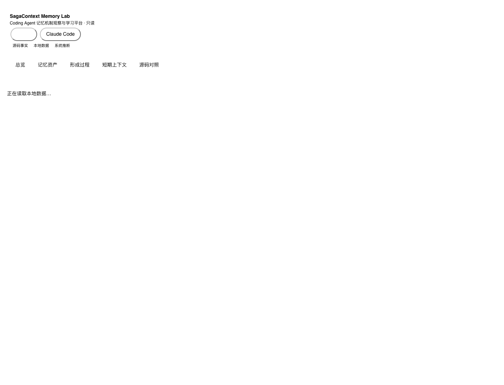
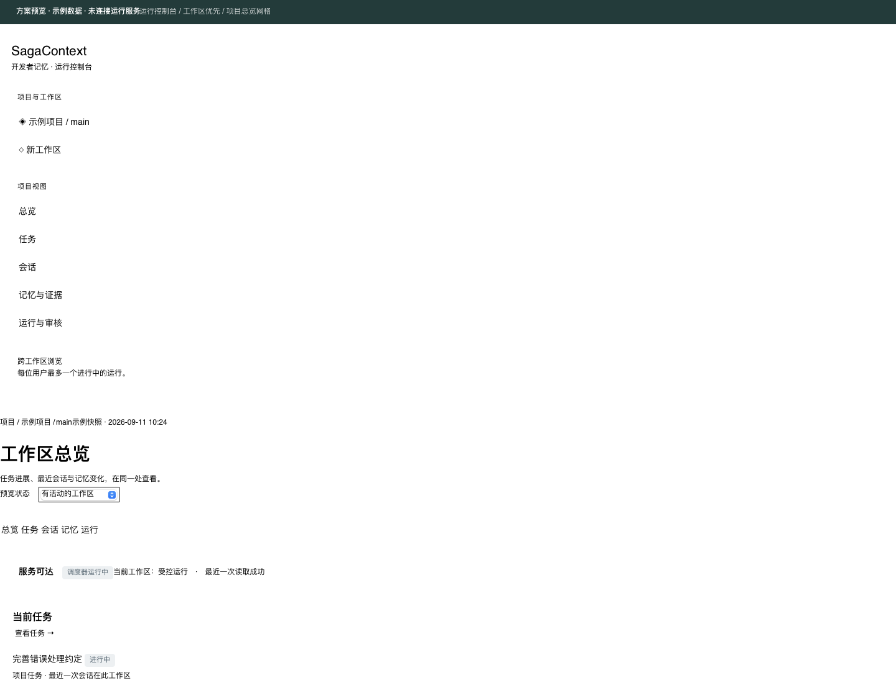

# SagaContext

**让 Coding Agent 记住你，也记住你的项目。**

SagaContext 是叠在 [OpenViking](https://github.com/volcengine/OpenViking) 之上的开发者个性化记忆层。它让 Claude Code 与 Codex 在你所有的项目里越用越懂你：知道你希望代码怎么写，知道这个仓库里做过哪些决定、踩过哪些坑，知道你上次做到哪。而且不只是"记得"，还会真的照做。

## 记忆机制观察与学习平台

SagaContext 自带一个只读的 **Memory Lab**，帮助你从“完全不了解 Codex 如何记忆”逐步走到能解释每一条记忆的形成过程。启动 Web 服务后访问 `/memlab/`，按产品切换 Codex 或 Claude Code。

平台围绕记忆资产组织内容：先看到 `MEMORY.md` / `memory_summary.md` 中的具体信息，再沿着单条信息追溯来源会话、候选抽取、整合写入、后续召回以及更新或取代。形成过程页把每个阶段和阶段之间的连接拆开说明，明确触发条件、传递内容、过滤规则、源码依据和通俗解释；短期上下文页则可播放上下文增长、压缩和保留内容，并按事件标签筛选会话开始、记忆注入、用户消息、模型回复和工具调用等事件。

所有结论都标注证据等级：`source` 是本地源码事实，`local_data` 是直接读取的本地文件/SQLite，`inference` 是平台基于两者拼接出的解释。平台只读本地数据，不执行记忆写入。

### Memory Lab 页面





## 项目全貌

项目由四层组成：宿主观测层接收 Codex/Claude Code 的会话事实；Ledger 与投影层保存可审计事件和状态；记忆维护层负责候选抽取、对账、写入、召回与取代；Memory Lab 以只读方式把源码事实、本地数据和推断串成可学习的页面。OpenViking 作为可插拔后端提供向量/分层存储能力，SagaContext 保留自己的证据、作用域和生命周期边界。

```text
Codex / Claude Code
        │ 会话与上下文事实
        ▼
Capture → Ledger → Projection / Reconcile
        │                 │
        │                 ├─ 候选抽取与阶段二整合
        │                 ├─ 作用域、召回、更新与取代
        │                 └─ OpenViking backend（可选）
        ▼
Memory assets + provenance + lifecycle
        │
        ▼
Memory Lab（总览 / 资产 / 形成 / 上下文 / 源码）
```

代码入口在 `src/sagacontext/`，其中 `memlab/` 提供页面和只读 API，`capture.py`、`ledger/`、`projection/`、`maintenance/` 和 `recall.py` 构成记忆机制主链路；`tests/` 与 `scripts/` 提供本地验收、探针和回放工具。



> **状态：** 已有可运行的 Python 实现：S1 Ledger、S2 持续维护已通过本地验收；G1/G3 准入、S3-1 真实 OpenViking 故障恢复、RecallPolicy、Codex Shadow、G5 删除/取代和 G6 三条跨会话合成链路均已通过。当前仍是隔离合成验收，未启用正常会话自动化；下文是产品目标，不代表全部已实现。

本地验证：`PYTHONPATH=src .venv/bin/python -m unittest discover -s tests -q`。当前真实后端交付见 [S3-1 故障恢复报告](docs/probes/2026-09-05-s3-1-openviking-recovery.md)，完整状态见 [文档索引](docs/README.md)。

[S3 纵向验收报告](docs/probes/2026-09-06-s3-policy-shadow-g5-g6.md)包含真实下一会话输入、任务结果和清理证据。

---

## 你大概遇到过这些

- 上周告诉 Agent"别用 `any`"，这周它又写了。
- 换一个仓库，它把上一个仓库的目录约定带了过来。
- 一个 pytest 挂起的坑，你在 Codex 里排过一次，换到 Claude Code 又踩一遍。
- 关掉终端再打开，它不知道你昨天做到哪了。
- 你说"以后测试都放 `tests/`"，它记下了；三个月后你改了主意，它还在用旧的。

现有的记忆方案大多把"发生过什么"一股脑存下来，然后按时间或相似度捞回来。它们没有区分"你是谁"、"你要什么"、"项目是什么"、"你在做什么"，也不会在新信息和旧记忆冲突时停下来问你一句。

## SagaContext 怎么做

**分层记，而不是混着记。** 六层记忆各有各的范围和寿命：

| 层 | 记什么 | 跟着谁走 |
|---|---|---|
| 用户 | 技术栈、经验、解释风格 | 你，跨所有项目 |
| 偏好 | 可判定的约定、你的每一次纠正 | 你，可按仓库或路径限定 |
| 项目 | 架构决策、模块地图、环境坑 | 仓库 |
| 任务 | 目标、做到哪、下一步 | 仓库里的一段工作 |
| 团队 | 同事定的约定，标明来源 | 仓库 |
| Agent 经验 | 对你和这个项目哪种做法有效 | 你 × 仓库 |

**以旧记忆为锚做对账，而不是从零抽取。** 每次会话开始，先按层召回和当前仓库、当前任务相关的记忆；会话结束时，把这些记忆和本次对话一起交给模型，让它判断新信息相对旧记忆是"确认、补全、推翻，还是全新"。语义相同的东西不会被写成两条，改了主意的偏好会被明确取代，真正冲突的进待确认队列，等你拍板。

**每条记忆都有出处、有范围、有生命周期。** 能回到产生它的那一轮对话；带全局 / 仓库 / 路径作用域，仓库 A 的东西不会带进仓库 B；带置信度和取代关系，长期没被印证的会自然退场。

**从"记住"到"遵守"。** 可判定的约定会被编译成可检查的规则：写文件前拦截、改动后跑 lint、路径约束。遵守和违反的结果反过来修正记忆的置信度。

**跨宿主。** Claude Code 和 Codex 共享同一份记忆，在一个里学到的，另一个里直接用。

**可评测。** 偏好遵守率、演化正确率、误注入率、事实回忆正确率、任务接续正确率，全部对照无记忆、宿主原生记忆、OpenViking 原生、Mem0、claude-mem 等基线。数字跑出来之前一律不写。

## 一个场景

周一，你在 Codex 里排掉了一个 CI 上 pytest 挂起的问题，原因是 asyncio fixture 没有正确取消。

周三，你在 Claude Code 里改到同一个测试文件，Agent 在动手前先提醒你这个坑和当时的修法。

周五，你说"以后 fixture 统一放 `conftest.py`"，这成了这个仓库的一条约定。

下个月，Agent 试图在别处新建 fixture，被拦下并附上这条约定；而在你的另一个仓库里，这条约定不会出现。

再往后，你改了主意，说"小模块可以就近放"。旧约定被标记为已取代，新约定生效，而"你曾经改过一次主意"这件事本身也被记住了。

## 为什么叠在 OpenViking 上

OpenViking 已经把记忆系统的基础设施做得很扎实：类型化 schema、字段级合并、多层命名空间、分层召回、使用反馈。缺的是面向开发者的内容模型和"越用越懂你"的机制。SagaContext 不重造这些基础，只做它之上的个性化层，以独立进程运行，通过公开接口对接。

## 了解更多

- [分层模型与对账循环](docs/05-分层模型与对账循环.md)：项目定位与核心机制
- [当前设计基线 v0.3](docs/superpowers/specs/2026-09-05-sagacontext-v0.3-design.md)：Ledger 权威边界、持续维护与分阶段验收
- [重新定位：个性化记忆](docs/03-重新定位-个性化记忆.md)：为什么是"个性化"，与现有方案的差异
- [审核意见](docs/02-审核意见.md)：竞品与先例的源码级对照
- [全部文档索引](docs/README.md)

## 许可证

Apache-2.0。OpenViking 作为独立服务运行，遵循其自身许可证。
